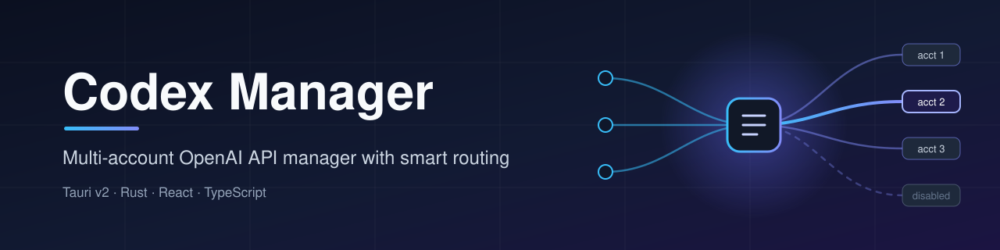
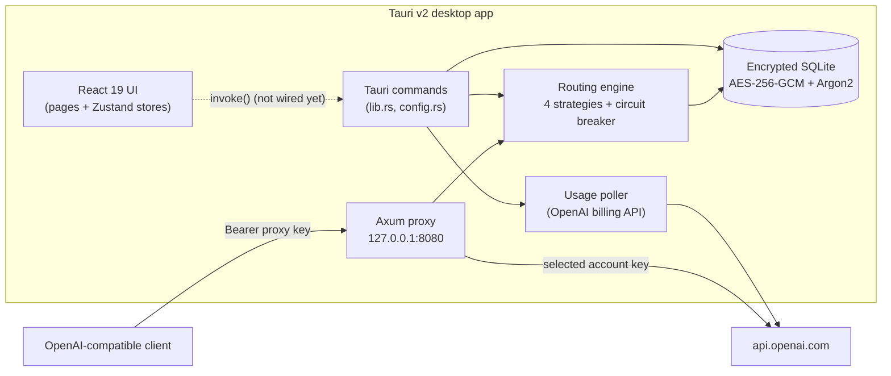

<div align="center">



**Multi-account OpenAI API manager with smart routing**

[](LICENSE)
[](https://github.com/muhib-karim/codex-manager)
[](https://github.com/muhib-karim/codex-manager/actions/workflows/ci.yml)

</div>

---

## What it is

Codex Manager is a desktop app (Tauri v2 + Rust + React/TypeScript) for people who juggle several
OpenAI API keys. It is designed to:

- keep accounts (label, API key, org ID, model scope, daily/monthly limits, priority) in an
  encrypted local SQLite database,
- poll OpenAI's billing/usage endpoints per account,
- expose a local OpenAI-compatible proxy (`http://127.0.0.1:8080/v1`) that picks an account for each
  request using a routing strategy.

> **Project status: work-in-progress prototype.** The React UI builds, type-checks and has a unit-test
> suite that runs in CI. The Rust backend is written but **does not compile yet**, and the UI is not
> yet wired to it (account state is in-memory in the browser). See [Roadmap / known limitations](#roadmap--known-limitations).

## Key features (as implemented in the code)

**Desktop UI** (`src/`, React 19 + Tailwind/DaisyUI + Zustand)
- Dashboard with account stats and a "best account" card
- Accounts page: add, search, grid/list view, pagination, batch select, enable/disable, delete, JSON export
- Settings page (general/language, proxy, notifications, appearance; persisted to `localStorage`) and an About page

**Rust backend** (`src-tauri/src/`, Tauri v2 commands)
- `routing.rs`: routing engine with 4 strategies (`least_utilized`, `round_robin`, `priority`, `sticky`),
  model-scope filtering and a per-account circuit breaker
- `storage.rs`: SQLite (rusqlite) store with AES-256-GCM-encrypted API keys, key derived with Argon2
- `usage.rs`: OpenAI client for billing usage / subscription / key validation, with back-off polling interval
- `proxy.rs`: Axum proxy with bearer-token auth, `/health`, `/v1/models`, `/v1/chat/completions`,
  `/v1/completions`, `/v1/embeddings`, `/v1/images/generations` and a catch-all passthrough
- `lib.rs`: 25 Tauri commands registered (account CRUD, usage refresh, routing stats, proxy start/stop, import/export, config)

There is also an earlier standalone CLI/TUI version of the backend in the root crate
(`Cargo.toml` + `src/*.rs`, using clap + ratatui), which shares the same design.

## Quick start

Requirements: Node.js 20+.

```bash
git clone https://github.com/muhib-karim/codex-manager.git
cd codex-manager
npm ci
npm run dev          # UI preview in the browser at http://localhost:1420
```

The full desktop app (`npm run tauri dev` / `npm run tauri build`) additionally needs a Rust toolchain
and the [Tauri system dependencies](https://tauri.app/start/prerequisites/). It will only work once
the backend compile errors listed below are fixed.

## Usage

| Command | What it does |
|---|---|
| `npm run dev` | Vite dev server for the React UI |
| `npm run typecheck` | `tsc --noEmit` over `src/` |
| `npm test` | Vitest unit tests (`tests/`) |
| `npm run build` | Type-check + production build into `dist/` |
| `npm run tauri dev` | Desktop app in dev mode (requires a compiling Rust backend) |

The proxy is designed to be used by any OpenAI-compatible client once the backend runs:

```bash
export OPENAI_BASE_URL="http://127.0.0.1:8080/v1"
export OPENAI_API_KEY="sk-codex-manager"   # the proxy's own key, not an OpenAI key
```

## Architecture



More detail: [docs/ARCHITECTURE.md](docs/ARCHITECTURE.md), [docs/API.md](docs/API.md), [docs/BUILD.md](docs/BUILD.md).

## Testing

```bash
npm ci
npm run typecheck
npm test        # 17 Vitest tests: formatting helpers + account store behaviour
npm run build
```

CI ([`.github/workflows/ci.yml`](.github/workflows/ci.yml)) runs exactly these steps on `ubuntu-latest`.
The Rust crates are not part of CI yet because they do not compile (see below).

## Project structure

```
codex-manager/
├── src/                    React + TypeScript UI (pages, components, stores, utils)
│   └── *.rs, */mod.rs      Root CLI/TUI Rust crate (clap + ratatui), earlier prototype
├── src-tauri/              Tauri v2 Rust backend
│   ├── src/                lib.rs, routing.rs, storage.rs, usage.rs, proxy.rs, config.rs, models.rs
│   └── tauri.conf.json
├── tests/                  Vitest unit tests
├── docs/                   Architecture, API, build notes, banner
├── .github/workflows/      ci.yml (checks) and release.yml (tag-triggered Tauri release)
├── Cargo.toml              Root CLI crate manifest
└── package.json
```

## Roadmap / known limitations

- **Tauri backend does not compile yet**: `models.rs` and `models/mod.rs` both exist (duplicate
  module), `storage.rs` uses `aes-gcm`/`argon2` which are not in `src-tauri/Cargo.toml`, and
  `config.rs` uses a store API from `tauri-plugin-store`, which is not a dependency.
- **Root CLI crate does not compile yet**: invalid `tower-http` feature (`compression`), a syntax
  error in `routing/mod.rs` (`Sticky = {`), axum 0.7 / aes-gcm 0.10 API mismatches, missing clap
  `env` feature, and a few borrow/lifetime errors.
- `derive_cipher` generates a new random salt on every open, so data encrypted in one session cannot
  be decrypted in the next. The salt needs to be persisted.
- The UI's account store is in-memory only; the Tauri `invoke()` calls still need to be wired up.
- `set_routing_strategy` is a placeholder that only logs the requested strategy.
- `release.yml` references `src-tauri/Entitlements.plist`, which does not exist.
- OpenAI's `/v1/dashboard/billing/*` endpoints used for usage polling are not part of the
  documented public API and may not work with standard API keys.

## License

[MIT](LICENSE) © 2026 Muhib Al Karim

If you find this useful, you can support it on [Ko-fi](https://ko-fi.com/ai_dev_2024).
